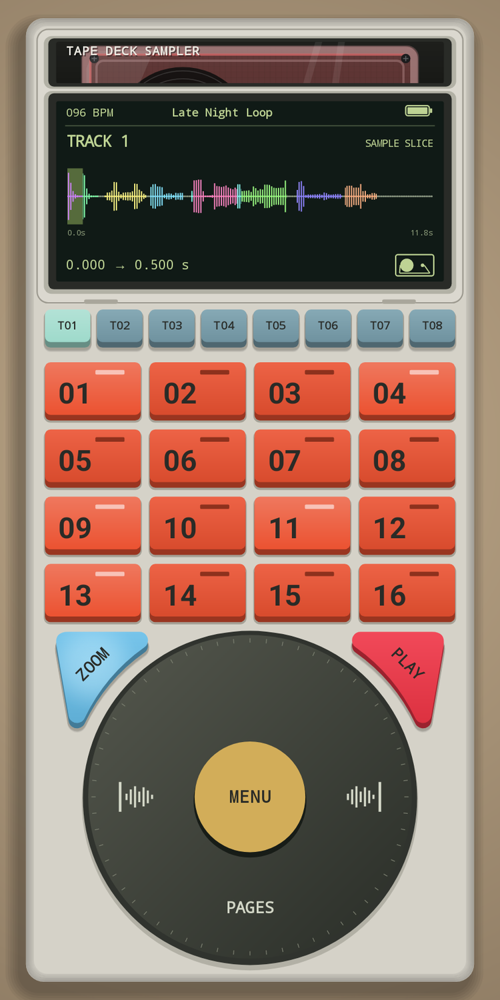
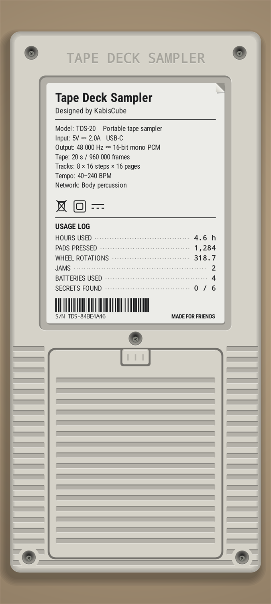

<p align="center">
  
  
</p>

# Tape Deck Sampler

Is an easy to use Android sampler with eight-tracks, sixteen-step sequencer with up to 16 pages.
Each project and its samples are stored on digital 48kHz mono cassette tape with a 20 second sample limit.

Record samples from the mic, another app, or load samples directly and slice them into your 20 second sample tape.

Start a jam session with a literal clap with no network or password requirements.


## Download

[Download from GitHub](https://github.com/KabisCube/Tape-Deck-Sampler/releases)


## Clap & Sync

Set the same **Tempo** on every device. Select **Sync** and just Clap once when all devices are ready. No network or passwords needed.

Devices can pause and play individually. When pressing **Play** a small delay will occur to get your device back in sync.
If you want to change the BPM, just change it on all devices at any time.
If another device wants to join, just Resync the devices, no data is lost.


## Recording and importing

**Record microphone** Simple mic recording using your device's microphone.

**Record device** captures audio from other apps on Android 10 or later. To allow for sampling any audio on your device. Android only permits capture from apps that allow it; so some sources may produce silence.

**Import sample** Import any audio sample directly from your storage without needing to record anything. The sample can then be trimmed and placed into your main 20 second sample.

**Text to speech** generates a sample using oldschool text to speach with 6 voices to pick from.

**Synth tone** generates a tone with a simple synth.

## Project

Every project is its own cassette tape with the samples and pad data stored on it.
As you make changes, the tape automatically saves your changes live. 


## Export
Tape Deck Sampler can export:
**As WAV** renders one pass through the enabled pages in numerical order, if the project use effects like Chance or Nth, it can use enough passes to reach every pad sound once: WAV exports are 48 kHz mono PCM16.
**As MIDI** exports the enabled sequence pages and track timing.
**As Project** exports a `.tapedeck.zip` with the tape and all pad data so it can be shared with other devices.


## Building

### Requirements

- JDK 17 (with `JAVA_HOME` set)
- Android SDK with platform 35 (with `ANDROID_HOME` set, or `sdk.dir` in `local.properties`)
- Android NDK 28.2.13676358 and CMake 3.22.1 (Android Studio or Gradle can install them)
- An Android 8.0+ device (API 26) to run it on

### Command line

```sh
./gradlew :app:assembleDebug      # Windows: gradlew.bat :app:assembleDebug
```

The APK ends up in `app/build/outputs/apk/debug/`. Install it with:

```sh
adb install -r app/build/outputs/apk/debug/app-debug.apk
```

You can also open the project in Android Studio and press Run.

Helper scripts for Windows and Linux (build and test, install on a phone, screenshots, releasing), release signing and publishing are in [tools/](tools/) and described in [tools/README.md](tools/README.md).


## License

Tape Deck Sampler is free software: you can redistribute it and/or modify it under the terms of the GNU General Public License as published by the Free Software Foundation, either version 3 of the License, or (at your option) any later version.

Tape Deck Sampler is distributed in the hope that it will be useful, but WITHOUT ANY WARRANTY; without even the implied warranty of MERCHANTABILITY or FITNESS FOR A PARTICULAR PURPOSE. See the [LICENSE](LICENSE) file for details.


## Credits

The Album Marker font (`app/src/main/assets/fonts/AlbumMarker01-Regular.ttf`), the hatch and tape sound effects (`app/src/main/assets/sounds/`) and the starter samples (`app/src/main/assets/samples/`) were made by KabisCube and licensed under the same GNU GPL v3-or-later license as the rest of this project.

Built with [Kotlin](https://kotlinlang.org/) by JetBrains. The Kotlin standard library is licensed under the [Apache License 2.0](https://www.apache.org/licenses/LICENSE-2.0).

Retro speech uses [eSpeak NG 1.52.0](https://github.com/espeak-ng/espeak-ng/tree/1.52.0), including its English pronunciation data, voice variants and UCD Tools, under **GPL-3.0-or-later**. Its Unicode data uses the **Unicode Data Files and Software License**. Both are compatible with this app's GPL-3.0-or-later license. License texts and attribution ship in `app/src/main/assets/licenses/`.

The native compiler runtime uses **Apache-2.0 with LLVM exceptions**, with legacy compiler-rt portions available under **MIT**. Its notices are included in `LLVM-compiler-rt.txt` alongside the speech licenses.

The complete upstream source is retained in `third_party/espeak-ng/espeak-ng-1.52.0.tar.gz` and compiled locally for Android. That source archive also includes unused Android bindings under **Apache-2.0** and Windows compatibility code under **BSD-2-Clause**; their original notices are preserved. The app does not build those components, MBROLA, Sonic or SpeechPlayer. See `third_party/espeak-ng/NOTICE.txt` for provenance and build details.

