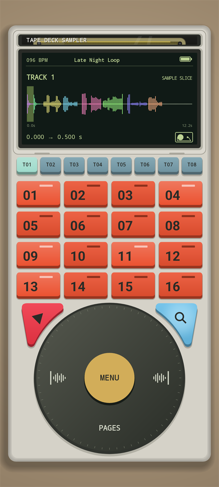
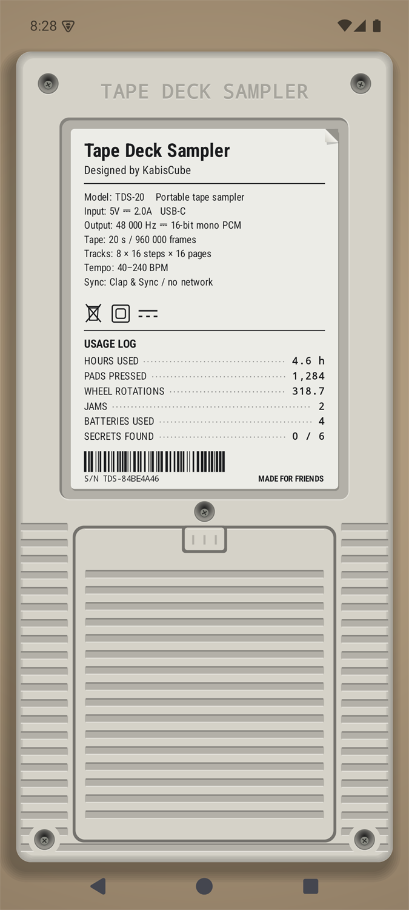

<p align="center">
  
  
</p>

# Tape Deck Sampler

Is an easy to use Android sampler with eight-tracks, sixteen-step sequencer with up to 16 pages that share a 20 second, 48kHz mono WAV "Tape" for all the samples. 

Record from your mic, another app, or load samples directly and slice them into your 20 second sample tape.

Tape Deck Sampler supports Project, MIDI and WAV exports.

## Download

[Download Tape Deck Sampler from GitHub Releases](https://github.com/KabisCube/Tape-Deck-Sampler/releases)

## Clap & Sync

Starting a jam is as simple as it should be.
Set the same **Tempo** on every device. Select **Sync** and just Clap once when all devices are ready. No network settings or passwords needed.

Devices can pause and play individually. When pressing **Play** a small delay will occur to get your device back in sync.
If you want to change the BPM, just change it on all devices at any time.
If another device wants to join, just Resync the devices, no data is lost.


## Recording and importing

**Add sample > Record microphone** Simple mic recording. Select where on your main 20 second sample you want to start recording from, and start recording. The recording can then be trimmed before committing it to the main 20 second sample.

**Add sample > Record device** captures audio from other apps on Android 10 or later. Start recording and switch to another app, play its audio, return and stop the recording. Recording can also be stopped through the notifications. The sample can then be trimmed and placed in your main 20 second sample.
Android only permits capture from apps that allow it; so some sources may produce silence.

**Add sample > Import sample** Import any audio sample directly from your storage without needing to record anything. The sample can then be trimmed and placed into your main 20 second sample.


## Project

Every project is its own tape cassette with the samples and pad data stored on it.
As you make changes, the tape automatically saves your changes live. 


## Export

**Menu > Project > Export**, **As MIDI**, **As WAV** and **As Project**.
**As MIDI** exports the enabled sequence pages and track timing.
**As WAV** renders one pass through the enabled pages in numerical order, or if you use chance effects, it can use enough passes to reach every pad sound once: WAV exports are 48 kHz mono PCM16.
**As Project** exports a `.tapedeck.zip` with the tape and all pad data so it can be imported on another device.


## Building

### Requirements

- JDK 17 (with `JAVA_HOME` set)
- Android SDK with platform 35 (with `ANDROID_HOME` set, or `sdk.dir` in `local.properties`)
- An Android 8.0+ device (API 26) to run it on

### Command line

```sh
./gradlew :app:assembleDebug      # Windows: gradlew.bat :app:assembleDebug
```

The APK ends up in `app/build/outputs/apk/debug/`. Install it with:

```sh
adb install -r app/build/outputs/apk/debug/app-debug.apk
```

You can also open the project in Android Studio and press Run.

### Windows scripts

- **Build Tape Deck Sampler.bat** runs the unit tests in `tests/`, builds debug and release APKs, runs lint and copies the release APK to `dist/TapeDeckSampler.apk`. Run `build.ps1 -TestOnly` to only run the tests.
- **Install Tape Deck Sampler to phone.bat** builds the release APK and installs it on one phone connected over USB with USB debugging on.
- **tools/render-battery-sleeves.ps1** redraws the battery label artwork in `app/src/main/res/drawable-nodpi` and a preview sheet in `dist/battery-brands.png`.
- **Start Tape Deck Sampler.cmd** runs the built APK in an Android emulator. It needs the SDK, emulator and the `android-35` x86_64 system image in `.tools/sdk`.

The scripts build with `gradlew` and use a JDK or SDK in the local `.tools/` folder if one is there (it is ignored by git). Otherwise the build script falls back to `JAVA_HOME` and `ANDROID_HOME`. The phone and emulator scripts expect `adb` and the emulator in `.tools/sdk`.

### Release signing

To sign release builds with your own key, create a keystore and copy `keystore.properties.example` to `keystore.properties` with your values:

```sh
keytool -genkeypair -v -keystore release.jks -alias tapedecksampler -keyalg RSA -keysize 4096 -validity 10000
```

Both `keystore.properties` and `*.jks` are ignored by git. If `keystore.properties` is missing, release builds are signed with the debug key instead.


## License

Tape Deck Sampler is free software: you can redistribute it and/or modify it under the terms of the GNU General Public License as published by the Free Software Foundation, either version 3 of the License, or (at your option) any later version.

Tape Deck Sampler is distributed in the hope that it will be useful, but WITHOUT ANY WARRANTY; without even the implied warranty of MERCHANTABILITY or FITNESS FOR A PARTICULAR PURPOSE. See the [LICENSE](LICENSE) file for details.


## Credits

The Album Marker font (`app/src/main/assets/fonts/AlbumMarker01-Regular.ttf`) is made by KabisCube and licensed under the same GNU GPL v3-or-later license as the rest of this project.

Built with [Kotlin](https://kotlinlang.org/) by JetBrains. The Kotlin standard library is licensed under the [Apache License 2.0](https://www.apache.org/licenses/LICENSE-2.0).

